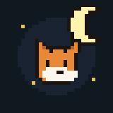
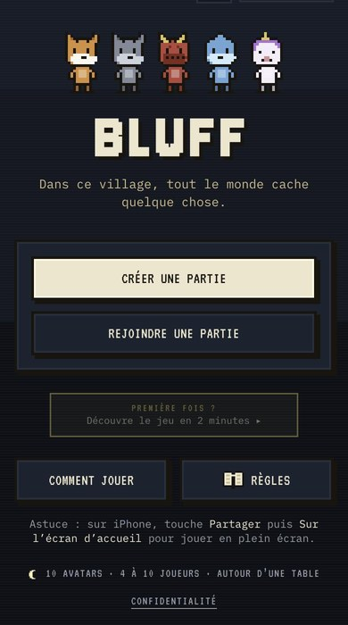
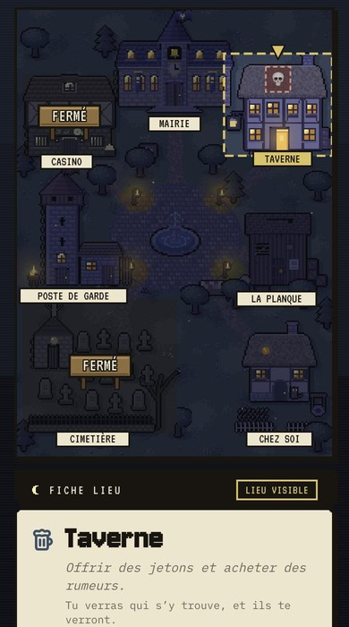
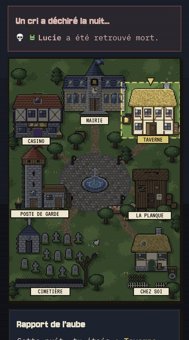
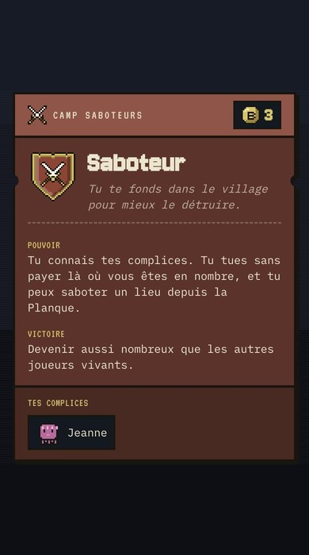
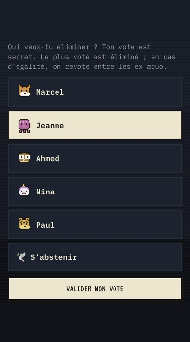
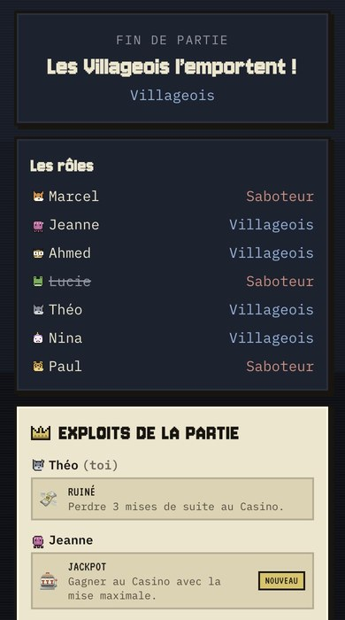
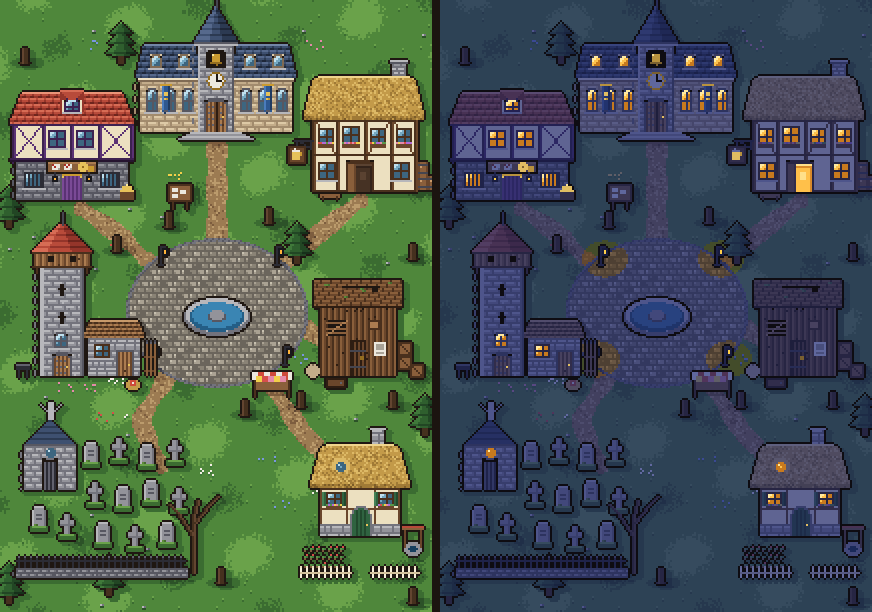

<div align="center">



# Bluff

**Dans ce village, tout le monde cache quelque chose.**

Jeu de société à rôles cachés, en pixel art, pour **4 à 10 joueurs** réunis autour d'une table, chacun sur son téléphone.

### [▶ Jouer sur bluff-village.vercel.app](https://bluff-village.vercel.app)

Gratuit · sans installation · sans compte obligatoire · en français

</div>

<p align="center">
  
  
  
</p>
<p align="center">
  
  
  
</p>

---

## Le jeu

Des **Saboteurs** se cachent parmi les **Villageois**. Chaque nuit, tout le monde se rend en secret dans un lieu du village pour y agir : enquêter, acheter une rumeur, parier, truquer le vote… Les Saboteurs, eux, profitent des lieux où ils sont en nombre pour frapper. Le jour, on débat à voix haute, on bluffe, on accuse, puis on vote.

Le téléphone sert de plateau et de meneur de jeu : il distribue les rôles, garde les secrets et résout la nuit. La discussion, elle, se passe autour de la table.

### Une manche

| Phase | Ce qui se passe |
|---|---|
| 🌙 **Nuit** | Chacun choisit en secret un lieu et une action, puis valide. |
| 🌅 **Aube** | Les morts de la nuit sont annoncés (le nom, pas le lieu). Chacun reçoit son rapport privé : qui il a croisé, ce qu'il a appris. |
| 🗣️ **Débat** | À voix haute, autour de la table. Raconte ta nuit, vraie ou inventée. |
| 🗳️ **Vote** | Vote secret, abstention possible. Le plus voté est éliminé et seul son camp est révélé. En cas d'égalité, on revote entre les ex æquo, puis tirage au sort. |

### Les camps

- **Villageois** : gagnent quand il n'y a plus aucun Saboteur.
- **Saboteurs** (1 jusqu'à 5 joueurs, 2 au-delà) : se connaissent entre eux et gagnent dès qu'ils sont aussi nombreux que les autres.
- **Solitaires** (en option, dès 7 joueurs) : jouent comme des Villageois mais visent une victoire personnelle.
  - *Le Capitaliste* gagne s'il détient 10 jetons.
  - *L'Opportuniste* parie en secret sur le camp gagnant.

### Les lieux

On gagne des jetons chaque nuit ; ils servent à agir dans les lieux.

| Lieu | Action | Coût |
|---|---|---|
| 🎰 **Casino** | Miser de 0 à 3 jetons : 60 % de chances de doubler la mise. | la mise |
| 🍺 **Taverne** | Offrir un jeton, ou acheter une rumeur : « y a-t-il au moins un Saboteur parmi ces joueurs ? » | 1 à 3 |
| 🗼 **Poste de garde** | Apprendre où un joueur a passé la nuit. Lieu discret : personne ne t'y voit. | 2 (1 avec 2 Saboteurs) |
| 🏛️ **Mairie** | Truquer le vote : +1 voix contre un joueur, ou 1 voix de moins contre soi. Échoue si quelqu'un d'autre y est. | 2 |
| 🪦 **Cimetière** | Interroger un fantôme et recevoir son suspect. Ouvert après le premier mort. | 1 |
| 🛖 **La Planque** | Réservée aux Saboteurs : saboter un lieu en secret (mises perdues, rumeurs inversées…). | 2 |
| 🏠 **Chez soi** | On n'y meurt jamais, mais pas deux nuits de suite. | gratuit |

Dans chaque lieu (sauf chez soi), si les Saboteurs sont plus nombreux que les autres présents, l'un des non-Saboteurs meurt ; à égalité, il y a 60 % de chances. Au plus un mort par lieu et par nuit. Les morts deviennent des **fantômes** : ils ne votent plus, mais chaque nuit ils observent un vivant et désignent un suspect. Un fantôme Saboteur, lui, hante un lieu pour aider ses alliés.

Toutes les valeurs (prix, chances, nombre de Saboteurs, Solitaires…) sont **réglables par l'hôte** dans le salon.

<p align="center">
  
  <br /><em>La carte du village, de jour et de nuit, entièrement générée en pixel art.</em>
</p>

## Fonctionnalités

- **Salon en 10 secondes** : un code de 4 lettres ou un lien à partager ; on joue en invité, sans inscription.
- **Compte optionnel** (e-mail ou Google) pour retrouver sa place sur n'importe quel appareil, garder ses statistiques et personnaliser son avatar (10 animaux, 8 tenues, 7 accessoires).
- **Tutoriel illustré** « Comment jouer » et astuces contextuelles pendant la première partie.
- **Transitions animées** entre les phases (tombée de la nuit, aube, élimination, victoire).
- **Musique chiptune et bruitages** générés en direct (Web Audio), sans qu'aucun son ne trahisse une action secrète.
- **Récap de fin de partie** commun à tous : exploits, trophées, bilan de chaque joueur et déroulé nuit par nuit.
- **Statistiques, 17 trophées** et page d'**équilibrage** (taux de victoire par camp et par nombre de joueurs).
- **Application installable** (PWA) : plein écran, écran gardé allumé pendant la partie.
- **Mode debug** : ajouter des bots et jouer à leur place pour tester seul.

## Sous le capot

| | |
|---|---|
| Interface | React 19, TypeScript, Tailwind CSS 4, Vite |
| Données et temps réel | Supabase : Postgres, Realtime, authentification anonyme et comptes |
| Hébergement | Vercel |
| Graphismes | Pixel art généré par des scripts Python (Pillow) : carte, sprites, avatars, icônes |
| Son | Synthétiseur Web Audio, aucun fichier audio |

Toute la logique du jeu vit dans la base : le client n'écrit jamais directement dans les tables, il appelle des fonctions SQL (`security definer`) qui vérifient chaque action. Les rôles, votes et actions des autres joueurs ne quittent jamais le serveur. La partie se synchronise en temps réel entre les téléphones, avec des filets de sécurité au retour de veille ou de réseau.

## Développer

Prérequis : Node.js et un projet Supabase.

```bash
npm install
```

Créer un fichier `.env.local` avec la clé **publique** du projet Supabase :

```bash
VITE_SUPABASE_URL=https://<projet>.supabase.co
VITE_SUPABASE_ANON_KEY=<clé publique anon>
```

```bash
npm run dev
```

Puis ouvrir http://localhost:5173. La page `/demo` (développement uniquement) montre tous les écrans avec des données factices.

- **Base de données** : les migrations sont dans [`supabase/migrations/`](supabase/migrations), à exécuter dans l'ordre (voir le [README des migrations](supabase/migrations/README.md)). Les tests de scénarios ([`supabase/tests/scenarios.sql`](supabase/tests/scenarios.sql)) tournent dans une transaction annulée et doivent finir par « TESTS OK ».
- **Graphismes** : `python3 tools/px/build.py` (sprites, icônes) et `python3 tools/px/build2.py` (carte du village), dans un environnement Python avec Pillow.
- **Production** : `npm run build`, déployé automatiquement par Vercel à chaque push sur `main`.

## Organisation du dépôt

```
src/
  pages/        écrans (accueil, salon, partie, règles, tutoriel, profil, stats…)
  components/   panneaux de jeu (nuit, aube, vote, fantôme, fin), carte du village, UI pixel
  data/         rôles, lieux, réglages, coûts, trophées, avatars
  hooks/        synchronisation temps réel avec Supabase
  lib/          appels à la base, son, comptes, application installable
supabase/
  migrations/   schéma et logique du jeu en SQL
  tests/        scénarios de test
tools/px/       générateurs du pixel art (Python)
public/         images, polices, icônes, service worker
```

La feuille de route et les notes de conception sont tenues à jour dans [`CLAUDE.md`](CLAUDE.md).

## Contact

bluff.village@gmail.com · [Politique de confidentialité](https://bluff-village.vercel.app/confidentialite)
